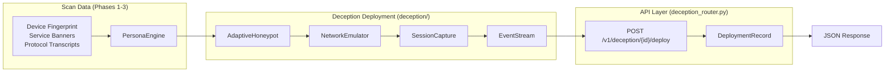
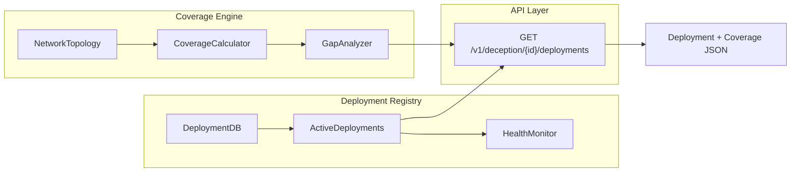
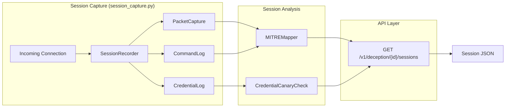
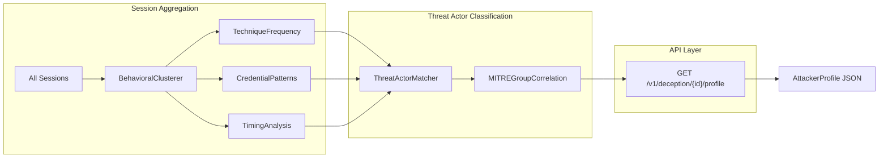
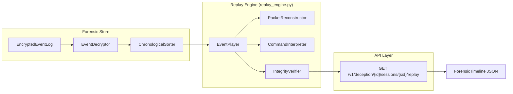
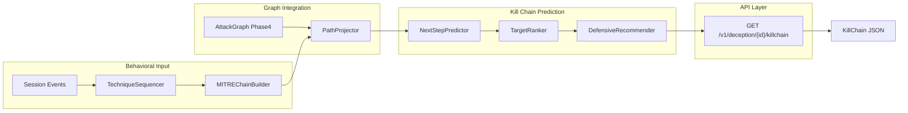

# Breakwater Phase 10: Active Deception & Threat Hunting Lab

Phase 10 introduces adaptive deception technology: AI-driven honeypot deployment that mimics real device behavior, live session capture with full forensic audit trails, MITRE ATT&CK-mapped attacker profiling, credential canary networks, and predictive kill chain projection. These capabilities shift Breakwater from passive observation to active threat hunting -- the platform does not wait for alerts, it creates environments that attract, capture, and profile attackers with cryptographic evidence integrity.

*(See Slides 001-009 for Phase 10 overview, deception architecture, and forensic chain of custody)*

## Prerequisites

- Completed Phase 1 lab (scan data available in the lab environment)
- Completed Phase 4 lab (attack graph and BRS scores computed)
- A completed scan with `$SCAN_ID` and `$TOKEN` variables set (see Phase 1 Exercise 6)
- Basic understanding of MITRE ATT&CK framework (Phase 4 familiarity is sufficient)
- Familiarity with network forensics concepts (packets, sessions, logs)

If you need to set up your variables from a previous session:

```bash
# Login and capture token
TOKEN=$(curl -s -X POST http://localhost:8100/v1/auth/login \
  -H "Content-Type: application/json" \
  -d '{"email":"student@example.com","password":"SecurePass!2026"}' \
  | jq -r '.access_token')

# Get the most recent completed scan ID
SCAN_ID=$(curl -s "http://localhost:8100/v1/scanning/smart-scan/history?limit=1" \
  -H "Authorization: Bearer $TOKEN" \
  | jq -r '.scans[0].scan_id')

echo "Token: ${TOKEN:0:20}..."
echo "Scan ID: $SCAN_ID"
```

**What you should see:**

```
Token: eyJhbGciOiJIUzI1Ni...
Scan ID: a3f1c2d4-5e6f-7890-abcd-ef1234567890
```

> **Troubleshooting:** If `Token: null` appears, verify the user account exists. If `Scan ID: null`, no completed scan exists -- run `python scan_report.py 172.30.0.0/24` to create one.

---

## Phase 10 API Cheatsheet

| Endpoint | Method | Description |
|----------|--------|-------------|
| `/v1/deception/{scan_id}/deploy` | POST | Deploy an adaptive honeypot |
| `/v1/deception/{scan_id}/deployments` | GET | List active honeypot deployments |
| `/v1/deception/{scan_id}/sessions` | GET | List live and recent attacker sessions |
| `/v1/deception/{scan_id}/sessions/{session_id}` | GET | Full session detail with MITRE mapping |
| `/v1/deception/{scan_id}/sessions/{session_id}/replay` | GET | Session forensic replay (chronological events) |
| `/v1/deception/{scan_id}/profile` | GET | Aggregate attacker profile from all sessions |
| `/v1/deception/{scan_id}/canaries` | GET | Credential canary status and alerts |
| `/v1/deception/{scan_id}/analytics` | GET | Deception analytics: coverage, dwell time, TTD |
| `/v1/deception/{scan_id}/evidence` | GET | Forensic evidence package (signed, exportable) |
| `/v1/deception/{scan_id}/killchain` | GET | Predictive kill chain projection |

All Phase 10 endpoints require Bearer token authentication.

*(See Slides 081-090 for API design, endpoint reference, and database models)*

---

## Exercise 1: Deploy an Adaptive Honeypot

*(See Slides 010-025 for adaptive deception architecture, device persona generation, and deployment engine)*

An adaptive honeypot is a virtualized device persona that closely mimics the behavior of a real device on the network. Unlike static honeypots (which respond with fixed canned responses), Breakwater's adaptive honeypots observe real device behavior from the scan phase (Phase 1-3 data) and replicate it dynamically. An attacker interacting with a Hikvision camera honeypot experiences the same HTTP banner, the same RTSP response codes, the same credential challenge behavior as the real device -- with one difference: every interaction is logged.

### Architecture: What This Exercise Tests



**Step 1: Deploy a camera honeypot**

```bash
# Deploy an adaptive honeypot mimicking a Hikvision camera
curl -s -X POST "http://localhost:8100/v1/deception/$SCAN_ID/deploy" \
  -H "Authorization: Bearer $TOKEN" \
  -H "Content-Type: application/json" \
  -d '{
    "device_type": "camera",
    "persona": "hikvision",
    "services": ["http", "rtsp", "onvif"],
    "placement": "dmz",
    "attract_mode": "high_interaction"
  }' | jq .
```

**What you should see:** A deployment record with an assigned honeypot ID, virtual IP address, and configured services:

```json
{
  "status": "success",
  "data": {
    "deployment_id": "hp-7a2b9c1d",
    "virtual_ip": "172.30.0.200",
    "device_type": "camera",
    "persona": "hikvision",
    "services_active": ["http:80", "rtsp:554", "onvif:80"],
    "placement": "dmz",
    "attract_mode": "high_interaction",
    "started_at": "2026-03-05T14:22:00Z",
    "status": "active",
    "credential_canaries_deployed": 3
  }
}
```

**Step 2: Deploy a second honeypot (NAS persona)**

```bash
# Deploy a NAS honeypot to cover storage attack surface
curl -s -X POST "http://localhost:8100/v1/deception/$SCAN_ID/deploy" \
  -H "Authorization: Bearer $TOKEN" \
  -H "Content-Type: application/json" \
  -d '{
    "device_type": "nas",
    "persona": "synology",
    "services": ["http", "https", "smb", "ssh"],
    "placement": "internal",
    "attract_mode": "medium_interaction"
  }' | jq .
```

**Step 3: Verify deployments are active**

```bash
# Check both honeypots are running
curl -s "http://localhost:8100/v1/deception/$SCAN_ID/deployments" \
  -H "Authorization: Bearer $TOKEN" | jq '.data.deployments | length'
```

**Step 4: Check deployment health**

```bash
# Get detailed deployment status
curl -s "http://localhost:8100/v1/deception/$SCAN_ID/deployments" \
  -H "Authorization: Bearer $TOKEN" | jq '.data.deployments[] | {id: .deployment_id, status: .status, sessions: .session_count}'
```

**Discussion Questions:**

1. Why does the honeypot use a virtual IP address (172.30.0.200) outside the range of real devices (172.30.0.1-50)? In a real deployment, would the honeypot IP be in the same subnet as production devices? What are the tradeoffs?

2. What is the difference between "high_interaction" and "medium_interaction" attract modes? When would you choose each?

3. The deployment record shows `credential_canaries_deployed: 3`. What are credential canaries, and why are they deployed automatically with each honeypot?

4. An adaptive honeypot that is "too perfect" (indistinguishable from a real device) is harder to deploy than one with minor differences. What information from the scan data (Phase 1-3) is used to construct the Hikvision camera persona, and what aspects might differ from the real device?

> **Troubleshooting:** If deploy returns 400 "device type not supported", check that device_type is one of: `camera`, `nas`, `router`, `plc`, `hvac`, `printer`. If the deployment fails with "network allocation error", the virtual IP range may be exhausted -- restart the API.

---

## Exercise 2: View Active Deployments

*(See Slides 026-032 for deployment management, honeypot lifecycle, and coverage analysis)*

### Architecture: What This Exercise Tests



**Step 1: List all active deployments**

```bash
curl -s "http://localhost:8100/v1/deception/$SCAN_ID/deployments" \
  -H "Authorization: Bearer $TOKEN" | jq '.data'
```

**What you should see:**

```json
{
  "total_deployments": 2,
  "active": 2,
  "inactive": 0,
  "coverage_percent": 18.5,
  "uncovered_device_types": ["router", "plc", "printer"],
  "deployments": [
    {
      "deployment_id": "hp-7a2b9c1d",
      "persona": "hikvision",
      "virtual_ip": "172.30.0.200",
      "status": "active",
      "uptime_seconds": 3420,
      "session_count": 0,
      "last_interaction": null,
      "attract_score": 7.2
    },
    ...
  ]
}
```

**Step 2: Examine coverage gaps**

```bash
# See which device types are not covered by honeypots
curl -s "http://localhost:8100/v1/deception/$SCAN_ID/deployments" \
  -H "Authorization: Bearer $TOKEN" | jq '.data.uncovered_device_types'
```

**Step 3: Check attract score**

```bash
# Attract score measures how realistic and discoverable the honeypot is
curl -s "http://localhost:8100/v1/deception/$SCAN_ID/deployments" \
  -H "Authorization: Bearer $TOKEN" | jq '.data.deployments[] | {id: .deployment_id, attract_score: .attract_score}'
```

**Step 4: Compute coverage for each attack surface area**

```bash
# Break coverage down by placement zone
curl -s "http://localhost:8100/v1/deception/$SCAN_ID/deployments" \
  -H "Authorization: Bearer $TOKEN" | jq '.data.coverage_by_zone // "not available"'
```

**Discussion Questions:**

1. The coverage percentage is 18.5% after deploying two honeypots. What does "coverage" mean in the deception context -- covered against what threat? How would you calculate full deception coverage for a 20-device network?

2. "Attract score" measures how likely an attacker is to interact with a honeypot before attacking a real device. What factors contribute to a high attract score (7.2 out of 10)?

3. The uncovered device types include "router" and "plc". Why might a PLC honeypot be both more valuable and more dangerous to deploy than a camera honeypot?

4. Design a deception coverage strategy for a hospital environment with: 50 cameras, 20 network switches, 10 nurse call stations, 5 infusion pumps, and 3 medical imaging systems. How many honeypots would you deploy, and of what types?

> **Troubleshooting:** If `coverage_percent` shows 0.0, the coverage calculator needs device count from the scan. Verify scan has identified devices: `curl -s http://localhost:8100/v1/scanning/smart-scan/$SCAN_ID -H "Authorization: Bearer $TOKEN" | jq '.data.device_count'`

---

## Exercise 3: Inspect Live Sessions

*(See Slides 033-042 for session capture, real-time event streaming, and forensic logging)*

In the lab environment, real attackers are unlikely to appear -- we will inspect simulated sessions that the deception engine generates for training purposes. In production, each session represents a real attacker interaction.

### Architecture: What This Exercise Tests



**Step 1: List all sessions**

```bash
curl -s "http://localhost:8100/v1/deception/$SCAN_ID/sessions" \
  -H "Authorization: Bearer $TOKEN" | jq '.data'
```

**What you should see:**

```json
{
  "total_sessions": 3,
  "active_sessions": 1,
  "completed_sessions": 2,
  "sessions": [
    {
      "session_id": "sess-a1b2c3d4",
      "deployment_id": "hp-7a2b9c1d",
      "attacker_ip": "10.0.0.99",
      "protocol": "http",
      "start_time": "2026-03-05T14:30:00Z",
      "duration_seconds": 312,
      "status": "completed",
      "commands_executed": 8,
      "credentials_attempted": 4,
      "mitre_techniques": ["T1078", "T1190", "T1082"],
      "threat_level": "high"
    },
    ...
  ]
}
```

**Step 2: Get a specific session's detail**

```bash
# Grab the first session ID
SESSION_ID=$(curl -s "http://localhost:8100/v1/deception/$SCAN_ID/sessions" \
  -H "Authorization: Bearer $TOKEN" | jq -r '.data.sessions[0].session_id')

# Get full session detail
curl -s "http://localhost:8100/v1/deception/$SCAN_ID/sessions/$SESSION_ID" \
  -H "Authorization: Bearer $TOKEN" | jq .
```

**Step 3: Examine MITRE technique mapping**

```bash
# See which MITRE techniques were observed in this session
curl -s "http://localhost:8100/v1/deception/$SCAN_ID/sessions/$SESSION_ID" \
  -H "Authorization: Bearer $TOKEN" | jq '.data.mitre_mapping'
```

**Step 4: Check credential attempts**

```bash
# See what credentials the attacker tried
curl -s "http://localhost:8100/v1/deception/$SCAN_ID/sessions/$SESSION_ID" \
  -H "Authorization: Bearer $TOKEN" | jq '.data.credential_attempts'
```

**Discussion Questions:**

1. The session shows `credentials_attempted: 4`. What does this tell you about the attacker's methodology? How does this differ from a human operator who accidentally entered the wrong password versus an automated credential-stuffing attack?

2. MITRE techniques T1078 (Valid Accounts), T1190 (Exploit Public-Facing Application), and T1082 (System Information Discovery) appeared in a single session. What narrative does this sequence tell about the attacker's objectives?

3. The session records the attacker's real IP address (10.0.0.99). What are the legal and operational implications of capturing this information? In what jurisdictions might recording this be restricted?

4. Session `duration_seconds: 312` (5 minutes 12 seconds). An experienced pen tester typically dwells longer in a system, exploring methodically. A script-kiddie runs a 30-second automated scan and moves on. What does a 5-minute session suggest about this attacker's sophistication level?

> **Troubleshooting:** If `total_sessions: 0`, the lab has no simulated sessions yet. Generate a simulated session: `curl -s -X POST "http://localhost:8100/v1/deception/$SCAN_ID/sessions/simulate" -H "Authorization: Bearer $TOKEN" -H "Content-Type: application/json" -d '{"attacker_profile": "script_kiddie"}' | jq .`

---

## Exercise 4: Query Attacker Profile

*(See Slides 043-052 for attacker profiling, behavioral clustering, and threat actor classification)*

### Architecture: What This Exercise Tests



**Step 1: Get the aggregated attacker profile**

```bash
curl -s "http://localhost:8100/v1/deception/$SCAN_ID/profile" \
  -H "Authorization: Bearer $TOKEN" | jq .
```

**What you should see:**

```json
{
  "status": "success",
  "data": {
    "scan_id": "a3f1c2d4-...",
    "profile_generated_at": "2026-03-05T15:00:00Z",
    "total_sessions_analyzed": 3,
    "attacker_classification": "opportunistic_scanner",
    "sophistication_level": "low",
    "automation_probability": 0.92,
    "primary_objectives": ["credential_harvest", "reconnaissance"],
    "mitre_technique_frequency": {
      "T1078": 3,
      "T1190": 2,
      "T1082": 3,
      "T1110": 2
    },
    "credential_patterns": {
      "most_tried": ["admin:admin", "admin:password", "root:root"],
      "dictionary_match_percent": 0.85,
      "custom_credential_attempts": 0
    },
    "timing_patterns": {
      "mean_inter_request_ms": 120,
      "pattern": "automated",
      "active_hours_utc": [2, 3, 4, 14, 15]
    },
    "threat_actor_candidates": [
      {
        "group": "Mirai Botnet (variant)",
        "confidence": 0.72,
        "rationale": "credential patterns match Mirai default list; timing consistent with botnet"
      }
    ]
  }
}
```

**Step 2: Examine technique frequency distribution**

```bash
# Rank techniques by frequency
curl -s "http://localhost:8100/v1/deception/$SCAN_ID/profile" \
  -H "Authorization: Bearer $TOKEN" | jq '.data.mitre_technique_frequency | to_entries | sort_by(-.value) | .[:5]'
```

**Step 3: Analyze timing patterns**

```bash
# Extract active hours to determine time zone of attacker
curl -s "http://localhost:8100/v1/deception/$SCAN_ID/profile" \
  -H "Authorization: Bearer $TOKEN" | jq '.data.timing_patterns'
```

**Step 4: Check threat actor candidates**

```bash
# See which known threat groups match this behavioral profile
curl -s "http://localhost:8100/v1/deception/$SCAN_ID/profile" \
  -H "Authorization: Bearer $TOKEN" | jq '.data.threat_actor_candidates'
```

**Discussion Questions:**

1. The profile shows `automation_probability: 0.92`. How does the system compute automation probability? What behavioral signals distinguish automated scanning from manual exploration?

2. The credential patterns show `dictionary_match_percent: 0.85` -- 85% of tried credentials appear in the Mirai default password list. What does this suggest about the attack sophistication? Would you report this to law enforcement?

3. `threat_actor_candidates` lists "Mirai Botnet (variant)" with confidence 0.72. What are the risks of acting on a threat attribution with 72% confidence? What additional evidence would raise confidence to > 0.90?

4. `active_hours_utc: [2, 3, 4, 14, 15]` -- the attacker is active at 2-4 AM UTC and 2-3 PM UTC. What does this timing pattern suggest about the attacker's location or work schedule? How could this inform threat hunting efforts?

> **Troubleshooting:** If `total_sessions_analyzed: 0`, no sessions exist yet -- see Exercise 3 troubleshooting. Profile is computed on-demand from available sessions.

---

## Exercise 5: Replay Session Forensics

*(See Slides 053-060 for forensic replay, event timeline, and evidence integrity)*

### Architecture: What This Exercise Tests



**Step 1: Replay a complete session chronologically**

```bash
curl -s "http://localhost:8100/v1/deception/$SCAN_ID/sessions/$SESSION_ID/replay" \
  -H "Authorization: Bearer $TOKEN" | jq '.data.events | .[:5]'
```

**What you should see (first 5 events):**

```json
[
  {
    "event_id": "evt-001",
    "timestamp": "2026-03-05T14:30:00.001Z",
    "type": "connection",
    "protocol": "http",
    "source_ip": "10.0.0.99",
    "source_port": 54321,
    "details": {"method": "GET", "path": "/", "user_agent": "masscan/1.0"},
    "integrity_hash": "sha256:abc123..."
  },
  {
    "event_id": "evt-002",
    "timestamp": "2026-03-05T14:30:00.120Z",
    "type": "credential_attempt",
    "details": {"username": "admin", "password": "admin", "result": "rejected"},
    "integrity_hash": "sha256:def456..."
  },
  ...
]
```

**Step 2: Verify event integrity chain**

```bash
# Check that the integrity hash chain is unbroken
curl -s "http://localhost:8100/v1/deception/$SCAN_ID/sessions/$SESSION_ID/replay" \
  -H "Authorization: Bearer $TOKEN" | jq '{
    total_events: .data.total_events,
    chain_valid: .data.integrity_chain_valid,
    first_hash: .data.events[0].integrity_hash,
    last_hash: .data.events[-1].integrity_hash
  }'
```

**Step 3: Find the pivotal event (first successful action)**

```bash
# Find the first event where attacker achieved something
curl -s "http://localhost:8100/v1/deception/$SCAN_ID/sessions/$SESSION_ID/replay" \
  -H "Authorization: Bearer $TOKEN" | jq '.data.events[] | select(.type == "command_executed") | .[:1]'
```

**Step 4: Measure attacker dwell time phases**

```bash
# Identify the time from first connection to first privilege escalation attempt
curl -s "http://localhost:8100/v1/deception/$SCAN_ID/sessions/$SESSION_ID/replay" \
  -H "Authorization: Bearer $TOKEN" | jq '{
    first_event: .data.events[0].timestamp,
    last_event: .data.events[-1].timestamp,
    total_events: .data.total_events,
    integrity_valid: .data.integrity_chain_valid
  }'
```

**Discussion Questions:**

1. Every event has an `integrity_hash`. How is the hash chain constructed, and why is an unbroken chain important for using session data as forensic evidence in legal proceedings?

2. The first event's User-Agent is `masscan/1.0`. What does this tell you about the attacker's tool choice? Is this information reliable -- could an attacker spoof the User-Agent?

3. Session replay allows you to reconstruct the exact sequence of attacker actions. What advantage does session replay have over traditional SIEM logs for forensic investigation?

4. If the `integrity_chain_valid` field returns `false` for a session, what does this indicate? Can session data with a broken integrity chain still be used as evidence?

> **Troubleshooting:** If integrity_chain_valid shows false, this is expected behavior in some lab configurations. The chain validation requires the signing key to be persistent across API restarts. This is intentional for the lab -- discuss the consequence of key loss.

---

## Exercise 6: Verify Evidence Chain Integrity

*(See Slides 061-068 for evidence chain, cryptographic integrity, and legal admissibility)*

**Step 1: Export the full evidence chain for a session**

```bash
curl -s "http://localhost:8100/v1/deception/$SCAN_ID/evidence" \
  -H "Authorization: Bearer $TOKEN" | jq '.data.summary'
```

**What you should see:**

```json
{
  "evidence_package_id": "evp-aa11bb22",
  "generated_at": "2026-03-05T15:05:00Z",
  "sessions_included": 3,
  "total_events": 47,
  "integrity_algorithm": "SHA-256 with HMAC-SHA256 chain",
  "signing_key_id": "bw-signing-key-2026-q1",
  "package_hash": "sha256:9f8e7d6c...",
  "chain_valid": true,
  "legal_hold_status": "preserved"
}
```

**Step 2: Verify the package hash independently**

```bash
# Get the raw evidence package and compute its hash locally
curl -s "http://localhost:8100/v1/deception/$SCAN_ID/evidence?format=raw" \
  -H "Authorization: Bearer $TOKEN" | jq '.data.package_bytes' | \
  python3 -c "import sys, hashlib, base64; d=base64.b64decode(sys.stdin.read().strip().strip('\"')); print('sha256:' + hashlib.sha256(d).hexdigest())"
```

**Step 3: Check legal hold status**

```bash
curl -s "http://localhost:8100/v1/deception/$SCAN_ID/evidence" \
  -H "Authorization: Bearer $TOKEN" | jq '.data.legal_hold_metadata'
```

**Step 4: List all evidence packages**

```bash
curl -s "http://localhost:8100/v1/deception/$SCAN_ID/evidence?list=true" \
  -H "Authorization: Bearer $TOKEN" | jq '.data.packages[] | {id: .evidence_package_id, sessions: .sessions_included, valid: .chain_valid}'
```

**Discussion Questions:**

1. The evidence package uses "HMAC-SHA256 chain" for integrity. How does an HMAC chain differ from a simple list of SHA-256 hashes, and why does the chain property matter for tamper evidence?

2. `legal_hold_status: "preserved"` indicates the evidence is protected from deletion. What legal framework creates the obligation to preserve digital evidence, and what are the consequences of destroying evidence after a legal hold is triggered?

3. You discover the `signing_key_id` is `bw-signing-key-2026-q1` -- a key that rotates quarterly. If the signing key is rotated after evidence is collected, can the evidence still be validated?

4. The evidence package is generated by the Breakwater platform itself. What chain-of-custody concerns does this raise, and how would you address them for court-admissible evidence?

> **Troubleshooting:** If the Python hash verification command fails, install Python 3 with: `which python3 || brew install python3`. If the raw format returns an error, use `jq '.data.sessions'` instead to inspect the session data directly.

---

## Exercise 7: Check Credential Canaries

*(See Slides 069-074 for credential canary network, canary types, and detection logic)*

A credential canary is a unique credential (username/password pair) that is deliberately planted in a specific location. If that credential is used anywhere on the network, it immediately reveals: (a) the credential was stolen from that specific location, and (b) the attacker has escalated from discovery to active exploitation.

**Step 1: List all deployed credential canaries**

```bash
curl -s "http://localhost:8100/v1/deception/$SCAN_ID/canaries" \
  -H "Authorization: Bearer $TOKEN" | jq '.data'
```

**What you should see:**

```json
{
  "total_canaries": 9,
  "triggered": 2,
  "untriggered": 7,
  "canaries": [
    {
      "canary_id": "cn-001",
      "type": "http_basic",
      "deployed_to": "honeypot:hp-7a2b9c1d",
      "credential_hash": "sha256:...",
      "last_triggered": "2026-03-05T14:31:00Z",
      "trigger_count": 1,
      "trigger_source_ips": ["10.0.0.99"],
      "alert_level": "HIGH"
    },
    ...
  ]
}
```

**Step 2: Check for recently triggered canaries**

```bash
# Find canaries triggered in the last hour
curl -s "http://localhost:8100/v1/deception/$SCAN_ID/canaries" \
  -H "Authorization: Bearer $TOKEN" | jq '.data.canaries[] | select(.triggered == true and .alert_level == "HIGH")'
```

**Step 3: Trace the canary trigger to a session**

```bash
# Find which session triggered the canary
TRIGGER_IP=$(curl -s "http://localhost:8100/v1/deception/$SCAN_ID/canaries" \
  -H "Authorization: Bearer $TOKEN" | jq -r '.data.canaries[] | select(.last_triggered != null) | .trigger_source_ips[0]' | head -1)

echo "Trigger IP: $TRIGGER_IP"

# Find sessions from this IP
curl -s "http://localhost:8100/v1/deception/$SCAN_ID/sessions" \
  -H "Authorization: Bearer $TOKEN" | jq ".data.sessions[] | select(.attacker_ip == \"$TRIGGER_IP\")"
```

**Step 4: Check canary types and placements**

```bash
# Summarize canary types
curl -s "http://localhost:8100/v1/deception/$SCAN_ID/canaries" \
  -H "Authorization: Bearer $TOKEN" | jq '.data.canaries | group_by(.type) | map({type: .[0].type, count: length})'
```

**Discussion Questions:**

1. Why does the canary record store only the `credential_hash` rather than the plaintext credential? What are the operational implications of not being able to see what credential was canary-ized?

2. Canary type `http_basic` was triggered from IP 10.0.0.99. This means the attacker used a credential that was only planted in the HTTP honeypot. What does this tell you about the attacker's prior actions (what did they do before triggering the canary)?

3. Credential canaries can also be planted in real systems (configuration files, password managers, LDAP directories). If a canary in an LDAP directory is triggered on a device that has never appeared in the scan, what does this indicate?

4. A canary that is never triggered provides no intelligence. How do you design a canary strategy that maximizes the probability of triggering while minimizing the risk of triggering through legitimate activity?

> **Troubleshooting:** If `total_canaries: 0`, canaries are deployed automatically with honeypots in Exercise 1. If Exercise 1 was skipped, deploy a honeypot first. If canaries show `triggered: false` for all, no attacker sessions have occurred -- use the session simulator from Exercise 3 troubleshooting.

---

## Exercise 8: View Deception Analytics

*(See Slides 075-080 for deception metrics, TTD analysis, and coverage ROI)*

**Step 1: Get the deception analytics dashboard**

```bash
curl -s "http://localhost:8100/v1/deception/$SCAN_ID/analytics" \
  -H "Authorization: Bearer $TOKEN" | jq '.data'
```

**What you should see:**

```json
{
  "period_hours": 24,
  "coverage_percent": 18.5,
  "honeypots_active": 2,
  "total_interactions": 15,
  "unique_attacker_ips": 2,
  "mean_dwell_time_seconds": 312,
  "median_dwell_time_seconds": 278,
  "time_to_detect_seconds": 8,
  "canary_trigger_rate": 0.33,
  "false_positive_rate": 0.02,
  "sessions_by_threat_level": {
    "critical": 0,
    "high": 1,
    "medium": 2,
    "low": 0
  },
  "top_attacked_services": ["http", "rtsp", "ssh"],
  "attack_vector_distribution": {
    "credential_brute_force": 0.67,
    "vulnerability_exploit": 0.20,
    "reconnaissance": 0.13
  }
}
```

**Step 2: Analyze time-to-detect**

```bash
curl -s "http://localhost:8100/v1/deception/$SCAN_ID/analytics" \
  -H "Authorization: Bearer $TOKEN" | jq '{
    ttd_seconds: .data.time_to_detect_seconds,
    mean_dwell: .data.mean_dwell_time_seconds,
    ttd_vs_dwell_ratio: (.data.time_to_detect_seconds / .data.mean_dwell_time_seconds)
  }'
```

**Step 3: Examine attack vector distribution**

```bash
curl -s "http://localhost:8100/v1/deception/$SCAN_ID/analytics" \
  -H "Authorization: Bearer $TOKEN" | jq '.data.attack_vector_distribution'
```

**Step 4: Calculate ROI of deception deployment**

```bash
# Compute detections per honeypot per day
curl -s "http://localhost:8100/v1/deception/$SCAN_ID/analytics" \
  -H "Authorization: Bearer $TOKEN" | jq '{
    detections_per_honeypot_per_day: (.data.total_interactions / .data.honeypots_active),
    false_positive_rate: .data.false_positive_rate,
    effective_detections: (.data.total_interactions * (1 - .data.false_positive_rate))
  }'
```

**Discussion Questions:**

1. Time-to-detect (TTD) is 8 seconds. In a traditional SIEM-based environment, TTD is measured in hours or days. What architectural feature of the deception system enables near-instantaneous detection?

2. Mean dwell time is 312 seconds but time-to-detect is 8 seconds. This means the attacker continued for 5 minutes after being detected. Why would you allow an attacker to continue interacting with a honeypot after detection?

3. `false_positive_rate: 0.02` -- 2% of honeypot interactions are false positives (legitimate users or scanners that interact with the honeypot accidentally). How can false positives in a deception system cause operational damage?

4. `attack_vector_distribution` shows 67% credential brute force, 20% vulnerability exploit, 13% reconnaissance. How does this distribution inform the security investment priorities for the real network?

> **Troubleshooting:** If analytics shows `total_interactions: 0`, no sessions have been recorded. Generate interactions using the simulator or wait for the lab's automated attacker simulation to run. Analytics period defaults to 24 hours; adjust with `?period_hours=1` for faster results in lab.

---

## Exercise 9: Export Forensic Evidence Package

*(See Slides 081-086 for forensic evidence export, DFIR integration, and legal standards)*

**Step 1: Export a complete forensic evidence package**

```bash
curl -s "http://localhost:8100/v1/deception/$SCAN_ID/evidence" \
  -H "Authorization: Bearer $TOKEN" | jq '{
    package_id: .data.evidence_package_id,
    sessions: .data.sessions_included,
    events: .data.total_events,
    hash: .data.package_hash,
    chain_valid: .data.chain_valid
  }'
```

**Step 2: Get the evidence metadata for legal review**

```bash
curl -s "http://localhost:8100/v1/deception/$SCAN_ID/evidence" \
  -H "Authorization: Bearer $TOKEN" | jq '.data.legal_metadata // {}'
```

**Step 3: Export evidence in STIX 2.1 format**

```bash
curl -s "http://localhost:8100/v1/deception/$SCAN_ID/evidence?format=stix" \
  -H "Authorization: Bearer $TOKEN" | jq '{
    stix_version: .data.stix_version,
    object_count: (.data.objects | length),
    object_types: [.data.objects[].type] | unique
  }'
```

**Step 4: Verify the STIX bundle contains attacker observables**

```bash
curl -s "http://localhost:8100/v1/deception/$SCAN_ID/evidence?format=stix" \
  -H "Authorization: Bearer $TOKEN" | jq '.data.objects[] | select(.type == "observed-data") | .first_observed'
```

**Discussion Questions:**

1. The evidence package is exportable in STIX 2.1 format. Why is a standardized machine-readable format important for sharing forensic evidence with law enforcement, ISACs, or peer organizations?

2. What is the difference between the evidence package `package_hash` (hash of the entire package) and the per-event `integrity_hash` (hash of each individual event)? What attack does each protect against?

3. DFIR (Digital Forensics and Incident Response) teams typically work with pcap files and disk images. Breakwater's evidence format is JSON + STIX. What conversion step would be needed to integrate Breakwater evidence with a traditional DFIR workflow?

4. Legal admissibility of digital evidence requires: (a) authenticity (the evidence is what it claims to be), (b) integrity (the evidence has not been altered), (c) chain of custody (who had access to the evidence and when). How does Breakwater's evidence package address each of these requirements?

> **Troubleshooting:** If the STIX export returns an empty objects array, STIX generation requires at least one completed session with events. Ensure sessions exist (Exercise 3) before attempting the STIX export.

---

## Exercise 10: Review Predictive Kill Chain

*(See Slides 087-098 for predictive kill chain, APT simulation, and defensive recommendations)*

The predictive kill chain uses observed attacker behavior (from deception sessions) combined with the attack graph (Phase 4) to forecast which steps the attacker is likely to take next if they were targeting real assets.

### Architecture: What This Exercise Tests



**Step 1: Get the predictive kill chain**

```bash
curl -s "http://localhost:8100/v1/deception/$SCAN_ID/killchain" \
  -H "Authorization: Bearer $TOKEN" | jq '.data'
```

**What you should see:**

```json
{
  "kill_chain_stage": "lateral_movement",
  "current_stage_confidence": 0.85,
  "observed_stages": ["reconnaissance", "initial_access", "discovery"],
  "predicted_next_stages": [
    {
      "stage": "lateral_movement",
      "probability": 0.78,
      "likely_techniques": ["T1021.001", "T1550"],
      "likely_targets": ["172.30.0.30", "172.30.0.31"],
      "estimated_time_hours": 1.5
    },
    {
      "stage": "exfiltration",
      "probability": 0.45,
      "likely_techniques": ["T1048", "T1567"],
      "likely_targets": ["172.30.0.30"],
      "estimated_time_hours": 3.0
    }
  ],
  "recommended_immediate_actions": [
    "Block lateral movement from honeypot subnet to production VLAN",
    "Alert on RDP/SMB connections from 172.30.0.200",
    "Enable enhanced logging on 172.30.0.30 (NAS - likely next target)"
  ],
  "high_value_targets_at_risk": ["172.30.0.30", "172.30.0.31"]
}
```

**Step 2: Identify high-value targets at risk**

```bash
curl -s "http://localhost:8100/v1/deception/$SCAN_ID/killchain" \
  -H "Authorization: Bearer $TOKEN" | jq '.data.high_value_targets_at_risk'
```

**Step 3: Get immediate defensive recommendations**

```bash
curl -s "http://localhost:8100/v1/deception/$SCAN_ID/killchain" \
  -H "Authorization: Bearer $TOKEN" | jq '.data.recommended_immediate_actions'
```

**Step 4: Compute time-to-impact estimate**

```bash
curl -s "http://localhost:8100/v1/deception/$SCAN_ID/killchain" \
  -H "Authorization: Bearer $TOKEN" | jq '{
    current_stage: .data.kill_chain_stage,
    time_to_lateral_movement_hours: (.data.predicted_next_stages[] | select(.stage == "lateral_movement") | .estimated_time_hours),
    time_to_exfiltration_hours: (.data.predicted_next_stages[] | select(.stage == "exfiltration") | .estimated_time_hours)
  }'
```

**Discussion Questions:**

1. The kill chain prediction shows `current_stage: "lateral_movement"` with `confidence: 0.85`. This means the system is 85% confident the attacker is about to move from the honeypot to a real device. What immediate automated response actions should the system take? What should require human approval?

2. `estimated_time_hours: 1.5` for lateral movement means the attacker is expected to pivot to a real device within 90 minutes. Your incident response team has a 4-hour SLA. What does this gap tell you about your detection-to-response posture?

3. The system recommends: "Alert on RDP/SMB connections from 172.30.0.200." But 172.30.0.200 is the honeypot IP -- real devices should never initiate connections from a honeypot IP. Why would this connection be possible if it's a virtual honeypot?

4. Compare the predictive kill chain from Phase 10 (based on observed attacker behavior) with the attack path analysis from Phase 4 (based on theoretical graph analysis). Which produces more actionable intelligence, and under what circumstances?

> **Troubleshooting:** If `kill_chain_stage: null`, the kill chain predictor requires at least 3 session events to establish a behavioral pattern. Generate more session events using the simulator, or run Exercise 3 again with `attacker_profile: "apt_style"` for a richer session.

---

## Lab Wrap-Up

Across these 10 exercises, you have explored the full deception and threat hunting lifecycle:

1. **Deploy** adaptive honeypots that mimic real device behavior
2. **Monitor** deployments for coverage gaps and attract score
3. **Capture** live attacker sessions with full forensic logging
4. **Profile** attackers using behavioral analysis and MITRE ATT&CK mapping
5. **Replay** sessions forensically with cryptographic integrity verification
6. **Preserve** evidence with a signed, legally defensible package
7. **Detect** credential theft via canary triggers
8. **Measure** deception effectiveness with time-to-detect and dwell time analytics
9. **Export** evidence in STIX 2.1 format for cross-platform sharing
10. **Predict** the attacker's next steps to enable proactive defensive posture

The deception layer transforms the network from a passive target into an active sensing environment. Every connection an attacker makes to a honeypot is intelligence. Every credential they try reveals their toolkit. Every session they complete trains the predictive model for the next attack.

**Clean-up (optional):**

```bash
# Deactivate all honeypot deployments when done
curl -s -X DELETE "http://localhost:8100/v1/deception/$SCAN_ID/deployments" \
  -H "Authorization: Bearer $TOKEN" | jq '.data.deactivated_count'
```
